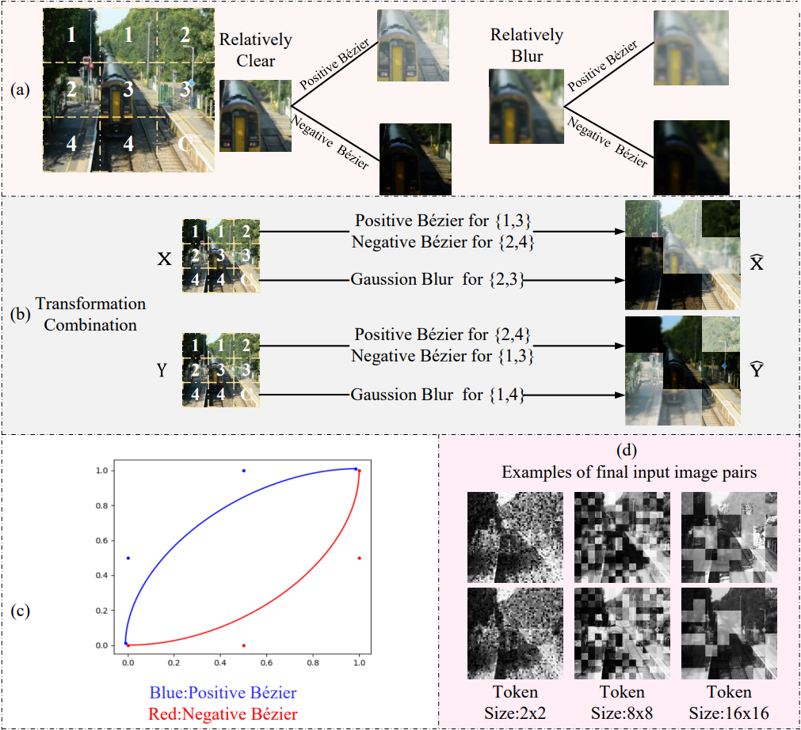
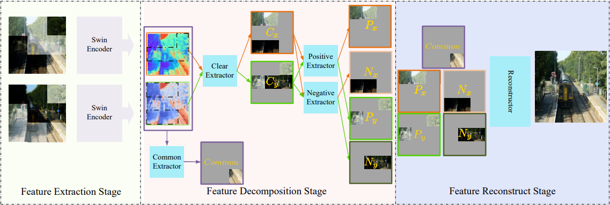

# DDBFusion

The official implementation of **“DDBFusion: An unified image decomposition and fusion framework based on dual decomposition and Bézier curves”**.

**Information Fusion 2025.**




## 🚀 Usage Guidelines

> **Note:** Our method converts input image pairs into grayscale for the decomposition and fusion process.

### 1. Grayscale Image Fusion
To generate fusion results for grayscale images:
```bash
python fuse_gray.py
```

### 2. Multi-Exposure & Multi-Focus Fusion (Color)
```bash
python fuse_rgb.py
```

### 3. Medical Image Fusion (Color)
```bash
python fuse_medical.py
```

📂 Results:
You can download the fusion results of DDBFusion from the link below: [Download Results (Google Drive)](https://drive.google.com/file/d/1_9TVZNBU9XIg95KbHBY7L7T7SD3KmlXv/view?usp=drive_link)


📝 Citation
If you find this work helpful for your research, please consider citing our paper:
```bash

@article{zhang2025ddbfusion,
  title={DDBFusion: An unified image decomposition and fusion framework based on dual decomposition and B{\'e}zier curves},
  author={Zhang, Zeyang and Li, Hui and Xu, Tianyang and Wu, Xiao-Jun and Kittler, Josef},
  journal={Information Fusion},
  volume={114},
  pages={102655},
  year={2025},
  publisher={Elsevier}
}

```
